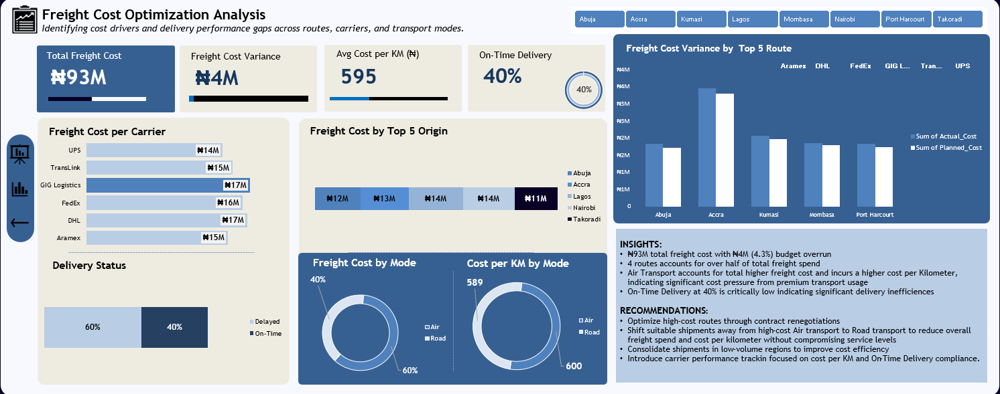

# Freight Cost Optimization Analysis | Microsoft Excel

## Project Overview

This project analyzes freight expenditure and delivery performance to identify cost inefficiencies, budget overruns, and operational gaps across transportation routes, logistics carriers, and transport modes.

Using Microsoft Excel, I developed an interactive dashboard to evaluate freight spending, compare carrier performance, monitor delivery reliability, and identify opportunities for logistics cost optimization.

The objective was to provide actionable insights that could help management control transportation costs, improve delivery efficiency, and make better logistics decisions.

## Business Problem

The business was experiencing significant freight expenditure alongside poor delivery performance.

However, management needed better visibility into:

- Which routes were responsible for the highest freight expenditure?
- Which logistics carriers incurred the highest transportation costs?
- How much was the business spending above its planned freight budget?
- Which transportation mode offered better cost efficiency?
- What proportion of deliveries were completed on time?
- Where could logistics costs be optimized without compromising delivery performance?

This analysis was designed to identify the major cost drivers and delivery performance gaps affecting logistics operations.

## Business Questions

1. What is the total freight expenditure compared with the planned budget?
2. Which routes contribute the most to total freight costs?
3. Which carriers incur the highest transportation costs?
4. What is the average freight cost per kilometre?
5. How do actual freight costs compare with planned costs across routes?
6. How do Air and Road transportation compare in terms of freight expenditure and cost per kilometre?
7. What percentage of deliveries are completed on time versus delayed?
8. Which areas present the greatest opportunities for freight cost optimization?

## Tools & Technologies

| Tool | Application |
|---|---|
| Microsoft Excel | Data analysis and dashboard development |
| Pivot Tables | Freight cost aggregation and performance analysis |
| Pivot Charts | Visualizing cost and delivery trends |
| Slicers | Interactive filtering by route and location |
| Excel Formulas | KPI calculations and performance metrics |
| Conditional Formatting | Highlighting cost variations and performance gaps |

## Key Performance Indicators (KPIs)

| KPI | Result |
|---|---:|
| Total Freight Cost | ₦93M |
| Freight Cost Variance | ₦4M |
| Budget Overrun | 4.3% |
| Average Cost per KM | ₦595 |
| On-Time Delivery Rate | 40% |
| Delayed Delivery Rate | 60% |

## Dashboard Analysis

### 1. Freight Cost Performance
- Compared actual freight expenditure against planned transportation costs.
- Evaluated overall freight budget variance.
- Identified a ₦4M budget overrun, representing approximately 4.3%.

### 2. Carrier Performance Analysis
- Compared freight expenditure across six logistics carriers.
- Identified high-cost carriers contributing significantly to transportation expenses.
- Evaluated carrier cost patterns to support vendor performance reviews.

### 3. Route-Level Cost Analysis
- Analyzed freight cost variations across major transportation routes.
- Identified four routes responsible for over half of total freight expenditure.
- Compared actual and planned freight costs to identify high-cost routes.

### 4. Transportation Mode Analysis
- Compared Air and Road transportation expenditure.
- Evaluated cost per kilometre across transportation modes.
- Identified higher freight expenditure and cost per kilometre associated with Air transportation.

### 5. Delivery Performance
- Evaluated delivery completion status across transportation operations.
- Identified a 40% on-time delivery rate against a 60% delayed delivery rate.
- Highlighted delivery reliability as a major operational improvement area.

## Key Findings

The analysis revealed the following:

- Total freight expenditure reached ₦93M, exceeding the planned budget by ₦4M (4.3%).
- Average freight cost per kilometre stood at ₦595.
- Only 40% of deliveries were completed on time, while 60% experienced delays.
- Four routes accounted for more than half of total freight expenditure.
- Air transportation contributed higher overall freight costs and higher cost per kilometre, indicating cost pressure associated with premium transportation usage.
- Carrier expenditure varied significantly, highlighting opportunities for improved vendor evaluation and cost control.

## Business Recommendations

Based on the findings, the following actions are recommended:

1. **Route Optimization:** Review high-cost routes and renegotiate freight contracts to reduce transportation expenditure.
2. **Transportation Mode Optimization:** Shift suitable shipments from Air to Road transportation where delivery timelines and service requirements permit.
3. **Carrier Performance Management:** Introduce carrier performance tracking focused on cost per kilometre, budget adherence, and on-time delivery.
4. **Delivery Efficiency:** Investigate the causes of the 60% delayed delivery rate and implement corrective measures to improve delivery reliability.
5. **Shipment Consolidation:** Consolidate shipments in low-volume regions to improve transportation efficiency and reduce logistics costs.

## Business Value

This project provides a consolidated view of freight expenditure, carrier performance, route-level cost variations, and delivery reliability.

It demonstrates how operational data can be transformed into actionable insights to support:

- Freight budget control.
- Transportation cost optimization.
- Carrier evaluation and contract negotiations.
- Route planning and transportation decisions.
- Improved delivery performance.

